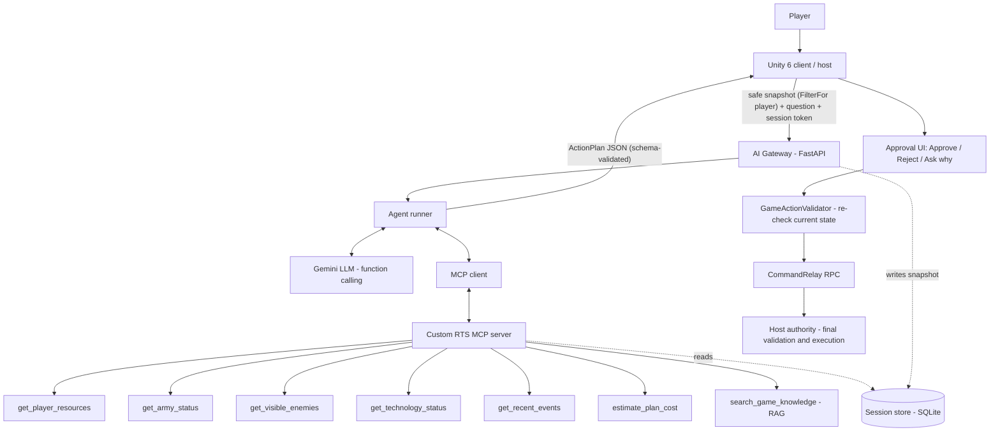

# M1 Design Brief — Agentic Multiplayer RTS

CSE-377 Game Programming · Unity 6 · Photon Fusion 2 (Host Mode) · Python MCP server · Gemini · local RAG

## 1. Game concept
A small two-player, Age-of-Empires-inspired RTS on one symmetric map. Players gather three resources,
build a base, train a counter-based army, advance one age, and win by destroying the opponent's Town Center.
An in-game **AI Strategic Commander** answers strategy questions and proposes structured plans that the
player must approve before anything happens.

All values below are our own design (not Age of Empires data). The canonical numbers live in
`ai/rag/knowledge/*.json` and are mirrored by Unity ScriptableObjects.

## 2. Rules summary

**Resources:** wood (trees, EastForest), food (berries, SouthField), gold (mines, WestMine).
Villagers gather 0.6/s, carry 10, deposit at the Town Center.
**Start:** 1 Town Center, 3 Villagers, 200 wood / 200 food / 100 gold, population 3/5.

| Unit | Cost | HP | Atk | Armor | Range | Speed | Trained at | Strong vs | Weak vs |
|---|---|---|---|---|---|---|---|---|---|
| Villager | 50F | 25 | 3 | 0 | 0.8 | 3.5 | Town Center | – | everything |
| Spearman | 50F 30W | 50 | 5 | 1 | 1 | 3.2 | Barracks | Cavalry | Archer |
| Archer | 35W 35G | 30 | 5 | 0 | 6 | 3.4 | Barracks | Spearman | Cavalry |
| Cavalry | 70F 60G | 100 | 8 | 2 | 1 | 5.5 | Stable (Age II) | Archer, Villager | Spearman |

Damage = max(1, attack × multiplier − armor); multiplier 1.5 when countering, 0.75 when countered.

| Building | Cost | HP | Provides / Function | Requires |
|---|---|---|---|---|
| Town Center | start only | 1500 | +5 pop, Villagers, drop-off, Age II, Horse Collar | – |
| House | 30W | 300 | +5 pop | – |
| Barracks | 150W | 800 | Spearman, Archer | – |
| Stable | 150W | 800 | Cavalry | Age II |
| Blacksmith | 120W | 700 | Iron Weapons, Fletching | – |

| Technology | Cost | Where | Requires | Effect |
|---|---|---|---|---|
| Age II | 400F 100G | Town Center | Barracks | unlocks Stable, Cavalry, Fletching |
| Iron Weapons | 100F 50G | Blacksmith | – | +2 attack for military |
| Fletching | 60F 60W | Blacksmith | Age II | Archer +1 range/LOS |
| Horse Collar | 75F 75W | Town Center | – | +20% food gather |

**Population:** max 50; each unit costs 1. **Fog of war:** line-of-sight based, per player.
**Win:** destroy the enemy Town Center. **Zones:** P1Base, P2Base, NorthGate, SouthField, EastForest, WestMine, Center.

```
            NorthGate
   P1Base ──── Center ──── P2Base
 WestMine     SouthField     EastForest
```

## 3. Networking choice: Photon Fusion 2, Host Mode
- The **host has StateAuthority** over every unit, building, resource stockpile and the match state. It runs
  NavMesh pathfinding, gathering, combat and fog-of-war visibility.
- Clients send **command requests** through a per-player `CommandRelay` (RPC InputAuthority → StateAuthority).
  The host validates ownership, cost, population, prerequisites and visibility before applying them.
- **AI-approved actions use exactly the same RPCs**, so they cannot bypass gameplay authority.
- Why Host Mode instead of Shared Mode: an RTS has a lot of shared, contested state (combat, resources).
  A single authority makes validation deterministic and easy to explain. The trade-off is that the host has
  zero latency (host advantage), which is acceptable for a classroom prototype.

## 4. System architecture



**Security boundaries**
1. Fog-of-war filtering happens in Unity **before** data leaves the game. The snapshot schema has no field
   for hidden data, and the gateway rejects unknown fields.
2. The player identity is bound to a server-side session token. The LLM never sees the token or a player id,
   and no tool takes a player id argument.
3. The MCP server exposes only read and compute tools. There are no filesystem, shell or HTTP tools, and no tool
   can change game state.
4. ActionPlans are validated three times: JSON Schema (gateway), GameActionValidator (Unity, on approval),
   and host authority (RPC handler).

## 5. AI components
- **MCP server:** Python `mcp` SDK, 7 tools (5 live-state tools, 1 cost calculator, 1 RAG tool), typed and
  range-checked inputs.
- **Agent:** provider-neutral loop (max 6 steps, 30 s timeout). The model decides which tools to call. Every
  call is logged to JSONL. The final answer is an `RTSActionPlan` (`ai/schemas/action_plan.schema.json`).
- **RAG:** knowledge records (`units.json`, `buildings.json`, `technologies.json`, `rules.md`) are chunked one
  record per chunk with a stable `source_id`. Retrieval uses a local sentence-transformers embedding plus BM25
  (hybrid) and returns the top-k chunks with their source ids.
- **Human in the loop:** read-only answers are shown directly. Any plan with actions needs explicit approval,
  and a rejected plan causes no state change.
- **Evaluation:** fixed snapshot fixtures and 14+ labelled prompts. We measure latency, tool-call accuracy,
  invalid-action rate and prompt-injection resistance.

## 6. Milestones
| | Target | Week |
|---|---|---|
| M1 | This brief, schemas, knowledge base | 1 |
| M2 | Networked core: gather, build, train, move | 2 |
| M3 | Combat, tech, fog of war, win condition, two-instance test | 3 |
| M4 | MCP server + agent + RAG (standalone, MCP Inspector) | 4 |
| M5 | Unity integration: panel, approval, validator, security tests | 5 |
| M6 | Evaluation, report, slides, build | 6 |
